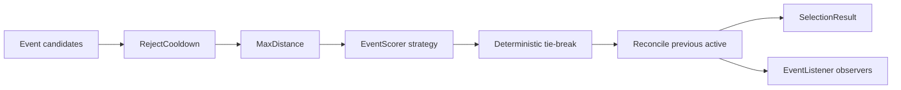

# Behavioral pattern project: Priority Event Arbiter

여러 후보 이벤트를 순서대로 검증하고 점수화한 뒤, **단 하나의 활성 이벤트**를 선택하는 행동 패턴 프로젝트입니다.

이 프로젝트에서 이벤트 관리 알고리즘은 계속 추가될 수 있다고 가정합니다. 따라서 이벤트 관리자를 거대한 `if` 문으로 키우지 않고, 다음 역할로 나눕니다.

- `EventFilter`: 후보를 통과시킬지 결정하는 Pipeline/Chain 단계
- `EventScorer`: 후보 점수를 계산하는 Strategy
- `EventArbiter`: 최종 선택과 이전 active 상태를 reconcile하는 Coordinator/State 역할
- `EventListener`: 활성화·비활성화 변경을 받는 Observer

## 왜 이 구조가 필요한가?

이벤트 관리 로직을 한 함수에 넣으면 처음에는 간단하지만, 거리·쿨다운·시간대·플레이어 상태·지역 규칙 같은 알고리즘이 추가될수록 기존 코드를 계속 수정해야 합니다.

### Before: 한 함수에 모든 정책을 넣기

```rust
fn select_event(events: &[Event], now: u64) -> Option<&Event> {
    let mut selected = None;

    for event in events {
        if event.cooldown {
            continue;
        }
        if event.distance > 20 {
            continue;
        }
        // 시간대, 플레이어 상태, 지역별 예외가 계속 이곳에 추가된다.
        if selected
            .map(|current: &Event| event.priority > current.priority)
            .unwrap_or(true)
        {
            selected = Some(event);
        }
    }

    let _ = now;
    selected
}
```

이 방식의 문제는 다음과 같습니다.

- 새 필터를 추가할 때 선택 함수가 변경됩니다.
- 점수 계산 알고리즘을 교체하기 어렵습니다.
- 왜 후보가 탈락했는지 각 단계가 드러나지 않습니다.
- 이전 이벤트의 비활성화와 새 이벤트의 활성화를 함께 관리하기 어렵습니다.
- UI, 사운드, 로그 코드가 선택 함수에 직접 결합되기 쉽습니다.

### After: 정책과 상태 전환 분리하기

```rust
let mut arbiter = EventArbiter::new(
    vec![
        Box::new(RejectCooldown),
        Box::new(MaxDistance::new(20)),
    ],
    Box::new(PriorityScorer),
);

let result = arbiter.reconcile(&candidates, &Context { now: 42 });
println!("active={:?}, changed={}", result.active, result.changed);
```

이제 새 필터는 `EventFilter`를 구현하고, 새 점수 정책은 `EventScorer`를 구현하면 됩니다. `EventArbiter`는 알고리즘의 구체적인 내용을 알 필요 없이 순서와 상태 전환만 관리합니다.

## 구조



실행 흐름은 다음과 같습니다.

1. `candidates`의 각 이벤트를 필터 Pipeline에 통과시킵니다.
2. 모든 필터를 통과한 이벤트에 scorer를 적용합니다.
3. 점수, priority, distance, id 순서로 하나를 결정합니다.
4. 이전 `active`와 새 선택 결과를 비교합니다.
5. 변경되었을 때만 listener에게 `SelectionResult`를 전달합니다.

## 단계별 강의 예제

이 프로젝트는 마지막에 한 번에 제시하는 과제가 아니라 행동 패턴 강의를
관통하는 사례다. 각 단계는 앞 단계의 테스트와 문제를 유지한 채 하나의
패턴만 추가한다.

| 단계 | 연결 강의 | 학습 초점 | 예제 |
| --- | --- | --- | --- |
| 00. 직접 구현 | 프로젝트 소개 | 모든 정책이 한 함수에 섞인 문제 | [direct](stages/00-direct.md) |
| 01. Strategy | Strategy | 점수 계산 정책 교체 | [strategy](stages/01-strategy.md) |
| 02. Pipeline | Chain of Responsibility | 필터를 순서대로 조합 | [pipeline](stages/02-pipeline.md) |
| 03. State | State | `Option<EventId>` 전환과 reconcile | [state](stages/03-state.md) |
| 04. Observer | Observer | 변경 시점에만 외부 통보 | [observer](stages/04-observer.md) |
| 05. Integrated | 행동 패턴 프로젝트 | 네 가지 패턴의 통합 | [integrated](stages/05-integrated.md) |

각 행동 패턴 페이지에서 해당 단계의 예제를 먼저 읽고, 이 README의 통합
구현으로 돌아와 전체 경계를 확인한다.

## 패턴별 역할

| 패턴 | 이 프로젝트의 역할 | 코드 위치 |
| --- | --- | --- |
| Strategy | 우선순위·거리 등 점수 계산 알고리즘 교체 | `EventScorer`, `PriorityScorer`, `DistanceScorer` |
| Pipeline / Chain of Responsibility | 후보를 여러 필터에 순차 통과 | `EventFilter`, `RejectCooldown`, `MaxDistance` |
| State / Coordinator | 이전 active와 새 active를 비교하고 상태 전환 | `EventArbiter::reconcile` |
| Observer | 활성화·비활성화가 발생했을 때 외부에 통보 | `EventListener`, `RecordingListener` |
| Result Object | 선택 결과와 전환 정보를 호출자에게 반환 | `SelectionResult` |

## 핵심 API

### 이벤트와 컨텍스트

```rust
pub struct Event {
    pub id: &'static str,
    pub priority: i32,
    pub distance: u32,
    pub cooldown: bool,
}

pub struct Context {
    pub now: u64,
}
```

활성 이벤트는 `Option<&'static str>` 하나만 저장합니다.

```text
None    → Some("a") : a 활성화
Some(a) → Some(b)   : a 비활성화, b 활성화
Some(a) → None      : a 비활성화
```

### 필터 Pipeline

```rust
pub trait EventFilter {
    fn accepts(&self, event: &Event, context: &Context) -> bool;
}
```

각 필터가 `false`를 반환하면 해당 후보는 scorer에 도달하지 않습니다. 따라서 `RejectCooldown`, `MaxDistance`, `PlayerStateFilter` 등을 독립적으로 추가할 수 있습니다.

### Strategy와 scorer 조합

```rust
pub trait EventScorer {
    fn score(&self, event: &Event, context: &Context) -> i32;
}
```

여러 전략을 함께 사용하려면 `CombinedScorer`에 넣습니다.

```rust
let scorer = CombinedScorer::new(vec![
    Box::new(PriorityScorer),
    Box::new(DistanceScorer),
]);
```

`CombinedScorer`는 각 scorer의 점수를 합산합니다. 실서비스에서는 가중치가 필요할 때 `WeightedScorer`를 추가하는 연습으로 확장할 수 있습니다.

### reconcile 결과

```rust
pub struct SelectionResult {
    pub previous: Option<&'static str>,
    pub active: Option<&'static str>,
    pub deactivated: Option<&'static str>,
    pub reason: String,
    pub changed: bool,
}
```

`A → B`이면 `previous=Some("a")`, `deactivated=Some("a")`, `active=Some("b")`입니다. `A → None`이면 `deactivated=Some("a")`, `active=None`입니다.

같은 이벤트가 계속 선택되면 `changed=false`이고 listener를 호출하지 않습니다. 이 규칙은 UI 갱신, 사운드 재생, 네트워크 전파가 매 tick마다 반복되는 문제를 막습니다.

## deterministic tie-break

총점이 같은 이벤트가 있어도 입력 순서에 따라 결과가 바뀌지 않도록 다음 순서를 사용합니다.

1. 총점이 높은 이벤트
2. 총점이 같으면 `priority`가 높은 이벤트
3. 그래도 같으면 `distance`가 짧은 이벤트
4. 그래도 같으면 `id`가 사전순으로 앞선 이벤트

결정 규칙은 테스트로 고정되어 있어 후보 배열 순서를 바꾸어도 같은 이벤트가 선택됩니다.

## 언제 사용하면 좋은가?

- 후보가 많고 여러 검증 단계를 통과해야 할 때
- 점수 계산 알고리즘이 기능별·제품별로 교체될 때
- 활성화와 비활성화 이벤트를 외부 시스템에 알려야 할 때
- 현재 상태와 새 계산 결과를 비교해야 할 때
- 정책을 조합하되 이벤트 관리자 자체는 안정적으로 유지하고 싶을 때

## 언제 사용하지 않는가?

- 후보가 두 개뿐이고 규칙도 거의 변하지 않을 때
- 단순한 정렬 한 번이면 충분할 때
- active 상태가 필요 없고 매번 계산 결과만 반환하면 될 때
- 필터와 scorer가 지나치게 많아져 오히려 흐름을 이해하기 어려워질 때

작은 문제에서는 단순한 함수가 더 읽기 쉽습니다. 패턴은 변경 가능성과 독립 테스트가 실제로 필요할 때 도입해야 합니다.

## 실행과 테스트

저장소 루트에서 실행합니다.

```bash
cargo run -p event-arbiter
cargo test -p event-arbiter
cargo fmt --all -- --check
```

통합 테스트는 `tests/arbiter.rs`에 있으며 다음을 검증합니다.

- 필터가 scorer보다 먼저 적용되는지
- 우선순위와 거리 scorer를 조합할 수 있는지
- 최고 점수 하나만 선택하는지
- 같은 active 유지 시 listener가 중복 호출되지 않는지
- `A → B`, `A → None` 전환의 `SelectionResult`가 정확한지
- tie-break가 입력 순서와 무관하게 결정적인지
- 사용자 정의 filter/scorer를 추가할 수 있는지

## 연습문제

1. `TimeWindowFilter`를 만들어 `Context::now`가 특정 시간 범위일 때만 이벤트를 통과시키세요.
2. `WeightedScorer`를 만들어 priority와 distance에 서로 다른 가중치를 적용하세요.
3. listener가 변경 원인별 통계를 누적하도록 `MetricsListener`를 구현하세요.
4. `EventArbiter`가 후보가 모두 탈락한 이유를 필터별로 기록하도록 `FilterDecision`을 설계하세요.
5. 이벤트 id를 `&'static str` 대신 소유 타입으로 바꾸려면 API와 수명 설계가 어떻게 달라지는지 비교하세요.

## 학습 질문

- 필터가 이벤트를 직접 활성화하지 않고 `bool`만 반환해야 하는 이유는 무엇인가요?
- `EventArbiter`가 listener에게 통보하기 전에 `active`를 변경하는 이유는 무엇인가요?
- 같은 점수에서 입력 순서를 그대로 사용하면 어떤 재현성 문제가 생기나요?
- Observer 알림과 `SelectionResult` 반환을 동시에 제공할 때 각각의 소비자는 누구인가요?
